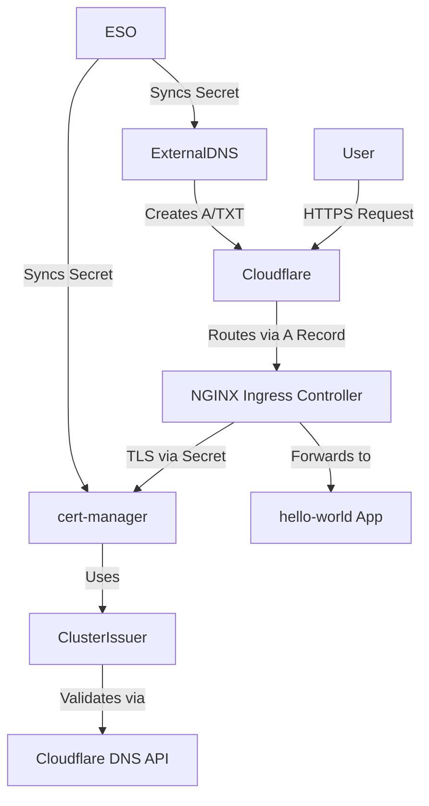

# DNS and HTTPS Reachability Overview for `hello-world` app

This document explains the components involved in securely exposing `hello-world-app-london`

to the public internet over HTTPS **using GitOps and ArgoCD.**

It also includes a quick debug tip using `/etc/hosts`.

## Applications with external access

### Ingress resources managed through GitOps

- Application Ingress manifests live in the application charts under
  `registry/apps/<application>/templates/`, for example the
  [Hello World template](../../registry/apps/hello-world/templates/hello-world.yaml).
- Argo CD ApplicationSets under `argo/2-applications/` deploy those charts to
  selected workload clusters.
- The [ingress controller ApplicationSet](../../argo/0-platform/ingress-nginx-config.yaml)
  installs NGINX Ingress using the
  [shared controller values](../../registry/clusters/workload/config/ingress-nginx/values.yaml).
- The controller's `LoadBalancer` Service provides an ingress address. ExternalDNS
  manages DNS records for configured Ingress hosts; the controller routes requests
  to the corresponding application Services.

### Certificates for each application

- The [certificate support ApplicationSet](../../argo/0-platform/cert-manager/cert-manager-support.yaml)
  deploys the support chart with cluster-specific overlay values.
- A [ClusterIssuer](../../registry/clusters/workload/support/cert-manager/templates/cluster-issuer.yaml)
  uses Let's Encrypt with Cloudflare DNS-01 validation.
- The [Certificate template](../../registry/clusters/workload/support/cert-manager/templates/certificate.yaml)
  requests wildcard certificates for the namespaces listed in each cluster's
  `cert_manager.wildcard.namespaces` values.
- cert-manager creates and renews the `wildcard-tls` Secret in each configured
  namespace. An application's Ingress references the Secret in its own namespace;
  it is not a single Secret shared across namespaces.
- ESO supplies the Cloudflare API credentials used by cert-manager and ExternalDNS.
  The TLS certificate Secret itself is managed by cert-manager.

### DNS records

- Cloudflare hosts the DNS zone. ExternalDNS watches the configured Kubernetes
  resources, including Ingress hosts, and reconciles DNS records and TXT ownership
  records.
- The [ExternalDNS ApplicationSet](../../argo/0-platform/external-dns-config.yaml)
  combines cluster overlays with the
  [shared configuration](../../registry/clusters/workload/config/external-dns/values.yaml).
- Its Cloudflare API token is delivered through ESO and GitOps-managed resources.
- Each cluster can expose its own application subdomain, such as
  `app.london.automatalife.com`. The examples below use `automatalife.com`; replace
  it with a domain you control and keep your manifests and values consistent.

## DNS & HTTPS Flow Overview

### 1. **ExternalDNS**

- **Purpose:** Automatically manages DNS records in Cloudflare based on Kubernetes resources (Ingresses).
- **How it works:**

  - Watches Ingress resources.
  - For any `host` found (e.g., `app.london.automatalife.com`), it creates or updates corresponding A and TXT records in your Cloudflare DNS zone.

- **Syncs every:** 1 minute.
- **Key Config:**

  - Connected to Cloudflare using a `cloudflare-api-token` secret.

### 2. **Cloudflare API Token Secret**

- **Purpose:** Provides access to Cloudflare's DNS API.
- **Details:**

  - Managed via External Secrets Operator (ESO).
  - Replicated into both `external-dns` and `cert-manager` namespaces.
  - Token must have `Zone.DNS:Edit` permissions.

### 3. **ClusterIssuer**

- **Purpose:** Defines how cert-manager should obtain TLS certificates.
- **Type:** ACME + DNS-01 challenge using Cloudflare.
- **Important fields:**

  - `email`: contact address for Let's Encrypt.
  - `server`: Let's Encrypt ACME URL.
  - `apiTokenSecretRef`: points to the `cloudflare-api-token` secret (in `cert-manager` namespace).

### 4. **cert-manager**

- **Purpose:** Automatically requests and renews TLS certificates from Let's Encrypt.
- **How it works:**

  - Uses the ClusterIssuer to create a wildcard certificate for `*.london.automatalife.com`.
  - Validates DNS-01 challenge using the secret injected by ESO.
  - Stores the final cert in a Kubernetes TLS secret (e.g., `wildcard-tls`).

### 5. **NGINX Ingress Controller**

- **Purpose:** Acts as a Layer 7 (HTTP/HTTPS) load balancer.
- **How it works:**

  - Listens on public IP (e.g., `74.220.20.97`) exposed via LoadBalancer service.
  - Routes HTTPS requests to the correct service (`hello`) using the Ingress definition.

### 6. **hello-world App**

- **Purpose:** Simple test app deployed via GitOps.
- **Resources:** One YAML containing:

  - Deployment
  - Service
  - Ingress (uses `wildcard-tls` for TLS termination)

- **Route exposed:** `https://app.london.automatalife.com`

---

## Quick local testing without DNS propagation

To test while waiting for DNS propagation, add a temporary local hostname mapping:

```bash
sudo nano /etc/hosts
```

Replace the example address and hostname with your ingress IP and configured domain:

```text
74.220.20.97   app.london.automatalife.com
```

Then open the hostname in your browser or use:

```bash
curl -v https://app.london.automatalife.com
```

This tests the ingress address directly from your machine; it does not verify
public DNS propagation or Cloudflare load-balancer routing. The TLS certificate
must still cover the configured hostname.

Remove the entry afterward to prevent stale DNS routing.

---

## Summary of Interactions



## DNS & Ingress Debugging – Step-by-Step

Use these checks to diagnose HTTPS access to an application, replacing
`app.london.automatalife.com` and `app.frankfurt.automatalife.com` with your configured hosts.

### Step 1: Check LoadBalancer service status

```bash
kubectl get svc -n ingress-nginx ingress-nginx-controller
```

- Ensure EXTERNAL-IP is assigned.

- Validate that type is LoadBalancer.

### Step 2: Confirm Ingress host exists

```bash
kubectl get ingress -A
```

- Ensure the host matches the desired `FQDN` (e.g. `app.frankfurt.automatalife.com`).

- Check that `tls.secretName` points to a valid `TLS` secret.

### Step 3: Inspect ExternalDNS logs

```bash
kubectl logs -n external-dns -l app.kubernetes.io/name=external-dns
```

Look for:

- Successful `creation` of `A` and `TXT` records.

- Conflicts or `DELETE` actions indicate misconfigured hosts or missing txtOwnerId.

### Step 4: Validate TXT Ownership

- Check that `txtOwnerId` and `domainFilters` are correctly set in:

```bash
registry/clusters/overlays/<cluster>/values.yaml
```

```yaml
txtOwnerId: frankfurt
domainFilters:
  - automatalife.com
```

-- If missing, `ExternalDNS` will fail to manage records reliably.

### Step 5: Confirm DNS in Cloudflare UI

- Navigate to `Cloudflare` DNS

- Check if:

\*\* `A` record exists for `app.<region>.automatalife.com`

\*\* Corresponding `TXT` record with `ownership` tag is present

### Step 6: Check TLS Secret Validity

```bash
kubectl get certificate -A
```

- Status should be `Ready=True`.

- Certificate must match your wildcard domain.

### Step 7: Test DNS Resolution

```bash
nslookup app.frankfurt.automatalife.com
dig +short app.frankfurt.automatalife.com
```

-- Should return your `LoadBalancer public IP`.

### Step 8: Final Live Check

```bash
curl -v https://app.frankfurt.automatalife.com
```

You should see the HTTP response from the hello-world app.
